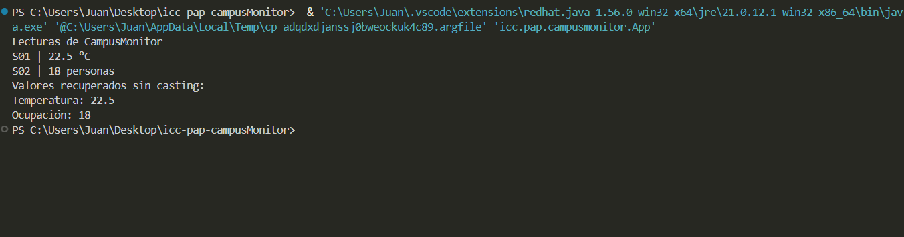

# 1. Implementación realizada

## ¿Qué representa la clase Lectura<T>?
Representa una clase que al ser instanciada puede recibir cualquier tipo de dato en este caso sin una cota o 
restricción especifica. Adicionalmente se añade el mismo tipo T a los atributos de esa clase como regla general.
## ¿Qué representa T y por qué permite utilizar la misma clase para temperatura y ocupación?
T representa tecnicamente un parametro de tipo, se permite usar la misma clase para temperatura y ocupación
porque al instanciar se puede pasar cualquier argumento de tipo de las dos clases
## ¿Qué agregaste en App.java?
Agregué las instancias de lectura con los diferentes argumentos de tipo, además de un formato de impresión que usa
los símbolos "|" y usando los getters de la clase. En App.java únicamente se colocan las instancias.

# 2. Ejecución correcta

