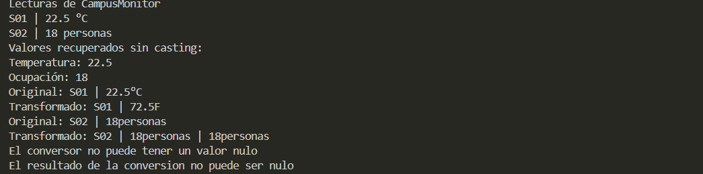

## 1. Implementación realizada 
R representa un parámetro de tipo (cualquier tipo de dato mientras no exista una restricción)
y transformar es genérico debido a que puede usar cualquier tipo para poder transformar a cualquier tipo
pero runTransformaciones tiene solamente la responsabilidad de inicializar el metodo de transformaciones, no es genérica
porque solamente se encarga de ejecutar ese método.

## 2. Ejecución correcta

El original es conservado debido a que solamente se obtienen sus datos a través de los getters, pero el resultado tiene otro tipo
porque no se está apuntando a otro objeto en memoria ni se lo está cambiando, el resultado puede tener otro tipo debido a la interfaz Function que permite regresar un resultado de otro tipo.